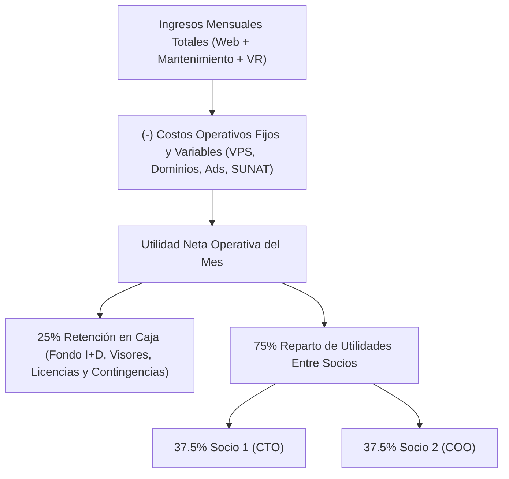

# ACUERDO DE SOCIOS, GOBERNANZA Y REPARTO DE UTILIDADES (50% / 50%)
## Empresa: LIMASYNC SOLUTIONS S.A.C. (En Formación / RUC 20)
**Socios Fundadores:**  
- **Socio 1 (Ingeniero de Sistemas):** Líder Técnico VR, Arquitectura de Shaders y DevOps (CTO)  
- **Socio 2 (Ingeniero de Sistemas):** Líder Comercial Web, Producto y Operaciones (COO)  

---

### 1. Objeto y Filosofía de la Sociedad Dual
La empresa opera bajo un modelo de sinergia complementaria:
1. **Unidad 1 — Agencia Web Lima (Liquidez & Cash Cow):** Genera flujo de caja inmediato mediante desarrollo express en 72 horas (S/ 500 setup) y cartera recurrente de mantenimiento (S/ 100/mes).
2. **Unidad 2 — Estudio XR Meta Quest (Activo Escalable & Moonshot):** Desarrolla propiedad intelectual de videojuegos en dólares en Meta Horizon Store financiado por el flujo de la Agencia Web.

---

### 2. Participación Societaria (Equity) y Vesting
- **Distribución de Acciones:** 50% Socio 1 / 50% Socio 2.
- **Vesting a 24 Meses:** Consolidación de acciones en 24 meses lineales con un **Cliff obligatorio de 6 meses**.
  - Si un socio decide retirarse antes de los 6 meses (antes de publicar el primer juego VR y superar los 15 clientes web activos), sus acciones revierten a la empresa a valor nominal.
  - Esto protege al socio que continúa empujando el proyecto ante deserciones prematuras.

---

### 3. Mecánica de Finanzas, Fondo de Reserva y Retiros Mensuales
De conformidad con el modelo financiero del negocio:

#### Reglas de Desembolso:
1. **Fondo de Reinversión Intocable (25%):** Se mantiene en la cuenta corriente de la empresa para cubrir servidores, licencias de software, assets 3D y pauta publicitaria sin requerir nuevos aportes personales.
2. **Condición de Retiro:** El 75% disponible se reparte en partes iguales siempre que ambos socios hayan cumplido con sus entregables y KPIs semanales de 40 horas dedicadas.

---

### 4. Estándares Operativos No Negociables
1. **Entrega de Webs en 72 Horas:** No se permite diseño desde cero fuera de las 5 plantillas maestras a precio de S/ 500. El límite de tiempo por web es de 8 horas efectivas de trabajo para proteger el margen del 91.4%.
2. **Alcance del Mantenimiento (S/ 100/mes):** Incluye hosting en VPS, SSL, backups semanales y hasta 2 cambios menores de textos/fotos. Modificaciones estructurales o nuevas secciones se cotizan como servicio adicional.
3. **Punto de Equilibrio (Hito Mes 4-5):** Al alcanzar 15 clientes en mantenimiento activo (S/ 1,500/mes recurrentes), todos los costos fijos de la empresa quedan cubiertos al 100%.
