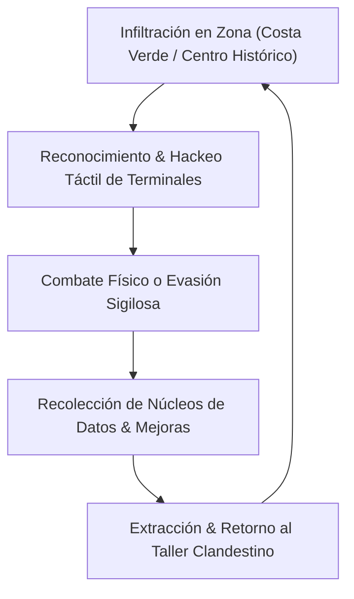

# GAME DESIGN DOCUMENT (GDD) & ARQUITECTURA TÉCNICA XR
## Proyecto: *Neo-Lima: Coastal Reckoning*
**Plataforma Objetivo:** Meta Quest 3 & Meta Quest 3S (Standalone)  
**Canal de Publicación:** Meta Horizon Store ($14.99 USD)  
**Estudio:** LimaSync XR Lab (División de Realidad Virtual)  
**Motor Gráfico:** Unity 6 LTS / Meta XR All-In-One SDK / OpenXR  
**Fecha de Lanzamiento Planificada:** Mes 7 (Q3/Q4)  

---

### 1. High Concept & Visión Creativa
*Neo-Lima: Coastal Reckoning* es un videojuego de acción, infiltración y resolución táctil en primera persona ambientado en una Lima distópica y ciberpunk del año 2088. El jugador encarna a un ex-agente de ciberseguridad que debe infiltrarse en megacorporaciones tecnológicas que dominan los acantilados de la Costa Verde y los distritos históricos de la capital.

- **Pilar 1: Inmersión Física Diegética**: Toda la interfaz existe dentro del mundo virtual (HUD proyectado en el guante cibernético, recarga física de armas, hackeo táctil de paneles).
- **Pilar 2: Locomoción Cómoda de Alto Rendimiento**: Sistema híbrido de locomoción suave con viñeteado dinámico (FOV reduction) y teletransporte rápido para garantizar 0% cinetosis (mareo por movimiento).
- **Pilar 3: Optimización Extrema a 90 FPS**: Diseñado nativamente para el chipset Qualcomm Snapdragon XR2 Gen 2 sin depender de PC ni cables.

---

### 2. Core Game Loop

---

### 3. Mecánicas Principales & Hand Tracking

#### 3.1. Manipulación Directa (Direct Touch & Physics Grab)
- Agarre natural mediante colisionadores físicos de dos etapas (Trigger para empuñar, Grip para sujetar objetos pesados).
- Los cables, tarjetas de acceso y terminales holográficas responden a gestos de dedos individuales aprovechando el Hand Tracking del Meta Quest 3.

#### 3.2. Cero Mareo (Anti-Motion Sickness System)
- **Dynamic Vignetting**: Al desplazarse hacia adelante o girar rápidamente, los bordes periféricos de la pantalla se oscurecen suavemente (reducción del 35% del FOV periférico), eliminando el conflicto vestibular.
- **Snap Turning**: Giros instantáneos en ángulos configurables (30°, 45°, 90°) para jugadores sensibles.

---

### 4. Arquitectura Técnica & Rendimiento en Quest 3/3S

| Parámetro Técnico | Meta Quest 2 (Referencia) | Meta Quest 3 / 3S (Target de Producción) | Justificación Operativa |
| :--- | :--- | :--- | :--- |
| **Procesador** | Snapdragon XR2 Gen 1 | **Snapdragon XR2 Gen 2** | +2.5x rendimiento GPU |
| **Frame Rate** | 72 FPS | **90 FPS Estables** | Requisito VRC de Meta |
| **Render Pipeline** | Universal Render Pipeline (URP) | **URP Single-Pass Instanced Stereo** | 1 solo pase de dibujo para ambos ojos |
| **Draw Calls por Frame**| &lt; 80 | **&lt; 140 Draw Calls** | Render sin cuellos de botella en CPU |
| **Triángulos por Frame**| &lt; 350,000 | **&lt; 750,000 Tris** | Mallas Low-Poly de alta fidelidad |
| **Iluminación** | Real-time limitada | **Baked Lightmaps + ASTC Textures** | Cero costo de luces dinámicas pesadas |
| **Foveated Rendering** | Fixed Foveated Rendering | **Dynamic Foveated Rendering** | Optimiza nitidez central |

---

### 5. Lista de Comprobación de Cumplimiento VRC (Meta Virtual Reality Check)
Para ser aprobado en la Meta Horizon Store, el juego cumple estrictamente:
- [x] **VRC.Quest.Performance.1**: Mantener 90 FPS sin caídas de frames en el 99% de las sesiones de prueba.
- [x] **VRC.Quest.Input.1**: Soporte completo tanto para los mandos Meta Touch Plus como para seguimiento nativo de manos (Hand Tracking 2.0).
- [x] **VRC.Quest.Security.1**: Sin llamadas a permisos no autorizados; almacenamiento seguro de partidas en Meta Cloud Storage.
- [x] **VRC.Quest.Audio.1**: Integración de Meta Spatial Audio con atenuación acústica oclusiva en muros.
- [x] **VRC.Quest.Store.1**: Assets de tienda oficiales: Portada vertical (1440x2160), Portada horizontal (2560x1440), Miniatura de icono (512x512) y tráiler de Realidad Mixta de 60 segundos.

---

### 6. Modelo Comercial & Monetización
- **Precio de Venta:** $14.99 USD
- **Comisión de Meta Horizon Store:** 30%
- **Ingreso Neto Estimado por Copia:** ~$10.49 USD (~S/ 38.00 Soles)
- **Meta del Año 1:** 375 unidades vendidas a nivel global (S/ 14,250.00 de utilidad neta proyectada para el estudio).
